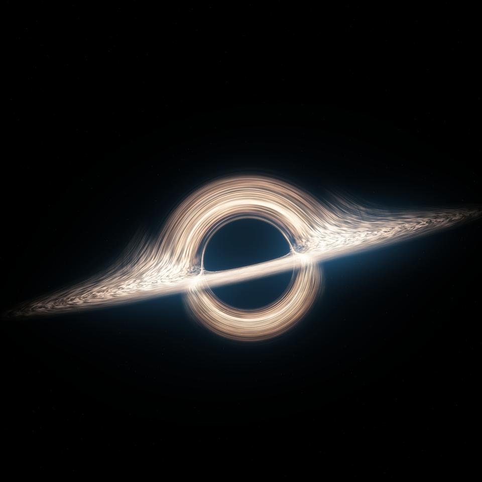

# 黑洞 · 纯 GLSL 动态拟合（glsl-black-hole）

**[English README](README.md)** · **[▶ 在线演示（WebGL 2）](https://sayed1145.github.io/glsl-black-hole/)** · [实现与验证报告](report/报告.md)

<p align="center">
  
</p>

引力透镜、上下折叠的暖白吸积盘、细光环、电影化镜头散射和星空——全部由 **4 个片元着色器（共 290 行 GLSL）** 外加一张很小的拟合辐射曲线表算出来。运行时不读任何贴图、HDRI 或图片；整个效果还能装进 **一个离线 HTML 文件** 在浏览器里实时运行。

> 📺 配套的 6 分钟 B 站解析视频《用 290 行 GLSL，复刻〈星际穿越〉黑洞》发布后会在这里补上链接。

## 亮点

- **光线弯曲**：从相机发射光线，在 Schwarzschild 型中心力场中（`a = -1.5 h² r⃗ / r⁵`，单位 `r_s = 1`）用 kick–drift–kick 积分，每个像素最多记录三次盘面交点——这就是主像、翘到上方的远侧盘面和细细的二级像的来源。瞄准距离小于临界值 `b_c = 3√3/2 · r_s ≈ 2.598 r_s` 的光线会落入黑洞，这个圆就是黑洞阴影（光子球 `1.5 r_s` 的像）。
- **程序化吸积盘**：域扭曲 fBm 噪声沿径向拉伸成细丝；三条各 18 个 RGB 控制点的径向辐射曲线；暖色约束与外沿衰减；掠射前景增强、二级像吸收、抗锯齿细环。
- **电影化合成**：四级浮点光晕（分离卷积）、暖色高光映射、冷蓝色镜头散射、稀疏程序星空、轻微边缘压暗。
- **8 秒无缝循环**：所有时间项都是周期函数，t = 0 与 t = 8 的帧逐像素一致（最大通道误差 0）。
- **两种前端**：离线 Python/[moderngl](https://github.com/moderngl/moderngl) 导出器（EGL，无显示器也能用 Mesa llvmpipe 跑），以及零依赖的 **WebGL 2** 交互版（暂停 / 拖动时间 / 调速 / 切换画质）。

## 它不是什么

**这是视觉拟合，不是科研级仿真。** 它是无自旋的 Schwarzschild 型透镜模型：**没有自旋、没有多普勒聚束、没有引力红移**；下半部盘面像的压缩是屏幕空间的美术调整；蓝色散射是镜头风格，并不表示阴影内部发光。完整的局限清单与验证数据见 [report/报告.md](report/报告.md)。

## 快速开始

### 1. 无需安装：交互版

用支持 WebGL 2 与 `EXT_color_buffer_float` 的浏览器打开 [`output/black_hole_live.html`](output/black_hole_live.html)，或直接访问托管版本：**https://sayed1145.github.io/glsl-black-hole/**

空格 = 暂停/播放；可拖动时间轴、调速、选择 720 / 1080 / 1920 画质（1920 能看到更细的光环与流纹）。

### 2. 从源码渲染 / 导出

建议 Python 3.10+，以及可用的 EGL / OpenGL 3.3 环境（Linux 无 GPU 时安装 `libegl1`、`libgl1-mesa-dri`；脚本默认 `LIBGL_ALWAYS_SOFTWARE=1`）。

```bash
python -m pip install -r requirements.txt
python render.py --size 1920 --output output/still.png --time 0          # 单帧
python export_animation.py --size 960 --supersample 2 --fps 25 --duration 8   # 8 秒循环 GIF/MP4
python build_viewer.py                                                  # 修改着色器后重建 output/black_hole_live.html
python fit_profiles.py --reference /path/to/reference.png               # 可选：重新拟合径向曲线（需要 SciPy）
python make_report.py --kind black_hole                                 # 可选：重新生成 Word 报告
```

## 目录结构

```
shaders/
  geometry.frag    光线弯曲 + 盘面求交（仅在分辨率/相机变化时重建）
  emission.frag    程序化盘面辐射、细丝、光环、二级像吸收
  blur.frag        四级光晕的分离卷积
  composite.frag   色调映射、镜头散射、星空、压暗
  radiance.glsl    拟合得到的径向辐射曲线（3 × 18 个 RGB 节点）
render.py              Renderer：离屏 EGL 上下文、多 pass 管线 → PNG
export_animation.py    8 秒循环 → GIF / MP4（Lanczos 缩放、调色板 + Sierra 抖动）
build_viewer.py        把着色器内联进 viewer_template.html → output/black_hole_live.html
fit_profiles.py        可选的离线曲线校准（唯一会读取参考图的脚本）
make_report.py         可选的 .docx 报告生成
radial_profiles.json   校准输出
output/                black_hole_live.html、black_hole_poster.png、validation.json
report/                报告.md、黑洞_实现与验证报告.docx、rendered.jpg
```

报告中提到的 20 MiB GIF 和 1920×1920 MP4 **没有**提交到仓库——用 `export_animation.py` 可以重新生成，或者直接看视频。校准时用过的方形参考图版权归属不明，因此也未随仓库分发；`fit_profiles.py` 可以接受你自己提供的任意参考图。

## 渲染流程

1. **geometry.frag**：每个像素从相机投射一条光线，在中心力场中积分；每次穿过盘面（最多三次）就把半径、方位角和入射信息写入浮点渲染目标。
2. **emission.frag**：在每个交点上计算周期性程序噪声与多层 fBm（`fbm(p + fbm(p))` 域扭曲），沿径向拉伸成细丝；拟合曲线给出颜色和亮度；叠加掠射增强、二级像吸收与抗锯齿细环。镜头固定，动态来自盘内流纹和局部亮度按不同相位演化，所有时间项都满足 8 秒周期。
3. **blur.frag**：÷2、÷4、÷12、÷24 四级光晕。
4. **composite.frag**：暖色高光映射、冷蓝散射、稀疏星空、边缘压暗。
5. **导出**：1920×1920 渲染 → Lanczos 缩到 960×960 → 256 色调色板 + Sierra 抖动编码 GIF；MP4 保留完整渐变。

## 验证结果（来自 `output/validation.json`）

| 检查项 | 结果 |
|---|---|
| 循环 | 200 帧 · 40 ms · 8000 ms · `loop = 0` |
| t = 0 与 t = 8 的着色器输出 | 最大通道误差 **0** |
| 相邻帧 / 首尾接缝的平均变化量 | 2.35 / 2.37（/255），无接缝跳变 |
| GIF 首帧量化 RMSE | 1.18 / 255（编码误差，不是与参考图的相似度） |
| WebGL 2 测试（Chromium） | 着色器编译通过 · `gl_error = 0` · 暂停/播放/重置/画质切换可用 |

## 参考资料

- O. James, E. von Tunzelmann, P. Franklin, K. S. Thorne, *Gravitational lensing by spinning black holes in astrophysics, and in the movie Interstellar*, Class. Quantum Grav. 32 (2015) 065001 — [arXiv:1502.03808](https://arxiv.org/abs/1502.03808)
- J.-P. Luminet, *Image of a spherical black hole with thin accretion disk*, A&A 75 (1979) 228
- E. Bruneton, *A Real-time High-quality Black Hole Shader*（2020）— https://ebruneton.github.io/black_hole_shader/
- R. Antonelli, *starless*（Schwarzschild 光线追踪器，`-1.5 h² r⃗ / r⁵` 测地线写法的来源）— https://rantonels.github.io/starless/
- I. Quilez, *Domain Warping* — https://iquilezles.org/articles/warp/ ；*The Book of Shaders* 第 13 章（fBm）
- Event Horizon Telescope Collaboration, *First M87 EHT Results I*, ApJL 875 L1 (2019)

以上仅作研究参考；本仓库中的着色器、参数拟合与导出流程均为独立实现，不包含上述网站的图片资产或代码。

## 许可证

[MIT](LICENSE) © 2026 sayed1145
